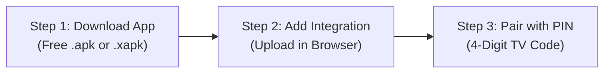

# 🔰 Beginner's Quick Start Guide: Set Up in Under 2 Minutes

Welcome! This guide is designed for **first-time users and beginners**. Starting in version **3.6.1**, setting up your TV in Home Assistant is completely automatic—**zero terminal commands, zero OpenSSL, zero manual unzipping, and zero Samba shares required**.

> [!NOTE]
> ### 📺 Works With ALL VIDAA OS Brands
> Whether your TV or smart projector is badged as **Hisense, Toshiba, Loewe, Philips, Sharp, JVC, TOPTRO, or any other brand**, if it runs **VIDAA OS**, this exact same setup works for you! All VIDAA devices share the exact same internal broker architecture and use the exact same communication certificate.

---

## 🎯 What You Will Need

1. **A web browser** connected to your Home Assistant dashboard.
2. **The free companion app archive** (`.apk`, `.xapk`, or `.p12`).
3. **Your TV turned on and connected to the same Wi-Fi / home network** as Home Assistant.

> [!IMPORTANT]
> **No Android Phone or Tablet Required!**  
> We only download the free mobile app package because the vendor bundled the TV's communication key inside it. Home Assistant extracts everything **automatically in memory** when you upload it through your browser. You never need an Android device or emulator.

---

## 🚀 3 Simple Steps

---

### Step 1: Download the Free Companion App File

1. On your computer or phone browser, open a trusted public mirror (such as [APKMirror](https://www.apkmirror.com/apk/vidaa-usa-inc/vidaa-smart-tv/)).
2. Search for: **VIDAA Smart TV** (by *VIDAA USA, Inc.*, package `com.universal.remote.multi`).
3. Download the free `.apk` or `.xapk` file to your computer or phone.
4. *(That's it! **Do not unzip or rename it**—Home Assistant will handle it directly).*

> [!TIP]
> If you already extracted `client_mobile_android.p12` or `El.p12` previously, you can upload that directly too!

---

### Step 2: Add Integration & Upload Directly in Home Assistant

1. In Home Assistant, navigate to **Settings → Devices & Services**.
2. Click the blue **Add Integration** button in the bottom right corner.
3. Search for **VIDAA Smart TV** and select it.
4. **Certificate Upload Form**:
   - If certificates are not already present on your system, Home Assistant will prompt: **"Upload VIDAA App or Certificate Archive"**.
   - Click the file selector and choose your downloaded `.apk`, `.xapk`, or `.p12` file (or drag and drop it into the box).
   - Click **Submit**.
   - *Home Assistant will instantly decrypt the keypair in memory and securely store the certificates for you!*

*(If you previously placed certificates in `/config/ssl/`, Home Assistant detects them automatically and skips this step).*

---

### Step 3: Enter Your TV's IP & 4-Digit Screen PIN

1. Enter your TV's local IP address (e.g. `192.168.1.50`).
   *(You can find this on your TV under **Settings → Network → Network Information**).*
2. Leave **Auth Profile** and **Brand** set to **Auto Detect (Recommended)**.
3. Click **Submit**.
4. **Enter the 4-Digit PIN**:
   - Look at your TV screen—a **4-digit PIN code** will appear!
   - Type that 4-digit code into the prompt in Home Assistant.
   - Click **Submit**.

🎉 **You're all done!** Your TV will appear in Home Assistant with full media controls, volume slider, input source selector, remote navigation, and app launcher.

---

## 💡 Quick Tips for the Best Experience

1. **Turn on "Wake on LAN" in TV Settings**:
   - On your TV remote, open **Settings → Network → Network Management** (or *Advanced Settings*).
   - Turn **Wake on LAN (WoL)** and **Wake on Wi-Fi** to **ON**.
   - This ensures Home Assistant can still turn the TV back on when it is in standby.
2. **Close the Phone App When Pairing**:
   - The TV's internal broker only allows one active remote control session at a time. If you have the official **VIDAA** mobile app open on your phone ([Apple App Store for iOS](https://apps.apple.com/us/app/vidaa/id1526408639) or [Google Play Store for Android](https://play.google.com/store/apps/details?id=com.universal.remote.multi)), force-close it before pairing in Home Assistant.
3. **4-Digit PIN Not Appearing on Your TV Screen?**:
   - **Check Terms of Use:** Ensure **Smart / Connected Services** are accepted (`Settings → Support / System → Terms & Conditions / Smart Services`). VIDAA OS suppresses the on-screen pairing PIN popup if connected services are disabled.  
   - **Check the TV's Clock (Firewall-Blocked / Isolated Sets):** If your TV is blocked from the internet by a firewall or DNS sinkhole, its internal clock may have drifted out of sync. Modern VIDAA TV brokers reject pairing challenges if the TV's internal clock differs from real time. Verify the time in **Settings → System → Time/Date** and reboot the TV.  
   *(Privacy Note: It is completely safe to block the TV from internet/WAN access at your router once pairing is finished, but ensure `UDP 123` / NTP is redirected to a local NTP server so the TV's clock stays accurate across reboots).*

---

## 🆘 Need More Help?

- ⚙️ **Want to customize buttons, sleep timers, and picture modes?** See [Configuration Parameters](parameters.md).
- 📱 **Want a beautiful virtual TV remote card on your dashboard?** See [Lovelace Remote Cards](lovelace_cards.md).
- 🎬 **Want to dim your living room lights when movies play?** See [Services & Automations](services_and_automations.md).
- 🔒 **Are you a network admin needing manual PEM keys or Root CA validation?** See [Advanced SSL Certificate Setup](certificates.md).
- 🩺 **Having trouble connecting?** See the [Troubleshooting Reference](troubleshooting.md).
